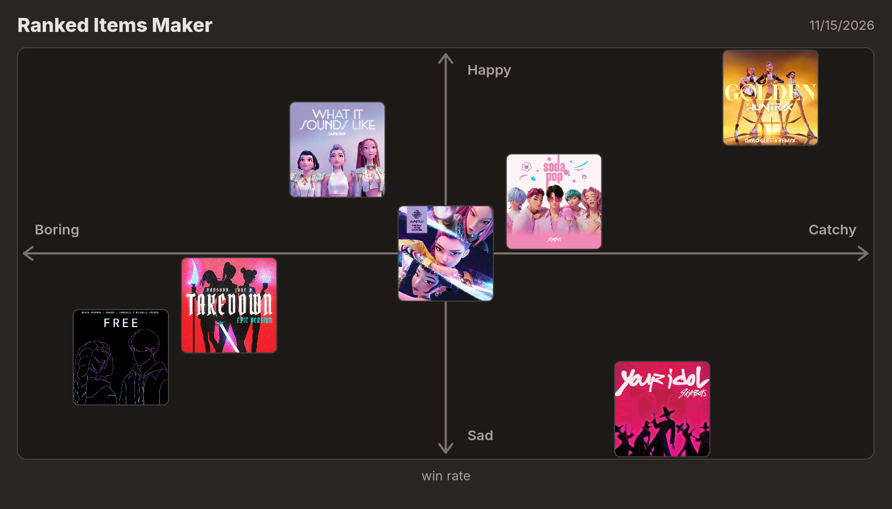

English | <a href="./README_fr.md">Français</a>

<h1 align="center">Ranked List Maker</h1>

A web app to rank items of a list in a quantified way <i>Heavily inspired by <a href="https://tiermaker.com/">Tier List Maker</a></i>

  
  

## 👋 Context

Ever wanted to rank items, but not in a subjective way?

I always thought that using duels to rank items would be much more useful (and representative) than using categories: compare items 1 vs 1, the winner gets +1, the loser -1.

Then, just show the scores on a axis (or two), and you have a nice representation of your items!

So, I made an app that does just that, enjoy 🎁!

## 🚀 How to use

Just head on to [loic-lhf.github.io/RankedList](https://loic-lhf.github.io/RankedList/) 📍 

Then, either use one of the templates, or make your own! 

> [!WARNING]
> This is a static website, so nothing is saved online.

> [!TIP]  
> You can save a JSON file to reuse your template later, or to send it to other people.

## 📞 Contact

Feel free to contact me if you encounter any problems or if you have any suggestions for new features you'd like to see included.

- 🐛 **Bug reports & issues:** Use [GitHub Issues](https://github.com/loic-lhf/RankedList/issues)
- 🦋 For anything else, contact me on [Bluesky](https://bsky.app/profile/loic-lhf.bsky.social)!

## ⚠️ Disclaimer

A significant proportion of this code was written with [claude.ai](https://claude.ai), [Anthropic](https://www.anthropic.com/)'s LLM (the free version though, because I don't have that kind of money). I systematically reviewed any code produced by [claude.ai](https://claude.ai), (tried) to understand it, and modified it when necessary. I believe that it is good practice to to work this way and to disclose any LLM usage, as **LLMs are just sources of informations, that cannot be blindly trusted.** 

*I can only recommend that everyone do the same.*