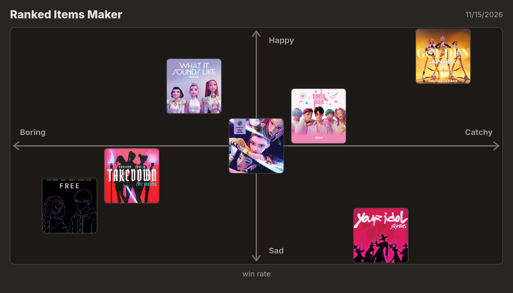

<a href="./README.md">English</a> | Français

<h1 align="center">Ranked List Maker</h1>

Une application web pour classer des éléments de manière quantifiée <i>Très fortement inspirée par <a href="https://tiermaker.com/">Tier List Maker</a></i>

  
  

## 👋 Context

Avez-vous déjà voulu classer des éléments, mais pas d'une manière totalement subjective ?

J'ai toujours trouvé qu'utiliser des duels était le meilleur moins de comparer les éléments d'une list. Et que le faire sur des gradients était bien plus représentatif que les organiser en catégories : en 1 vs 1, le gagnant score +1 et le perdant score -1.

Ensuite, il suffit de représenter les scores de chaque éléments sur un axe (ou plusieurs) et voilà !

Du coup, j'ai créé un site web qui fait exactement ça, ouvert à tous 🎁 !

## 🚀 Comment l'utiliser

Rendez-vous sur [loic-lhf.github.io/RankedList](https://loic-lhf.github.io/RankedList/) 📍 

Ensuite, vous pouvez soit utiliser un des modèles déjà prêts, soit créer le votre ! 

> [!WARNING]
> Il s'agit d'un site web *"statique"*, cela signifie que rien n'est sauvegardé en ligne.

> [!TIP]  
> Pour sauvegarder vos données, vous pouvez donc exporter un fichier JSON qui permettra à vous (où à n'import qui avec ce fichier) de recréer votre classement.

## 📞 Contact

N'hésitez pas à me contacter en cas de problèmes ou si vous avez des suggestions pour des ajouts que vous aimeriez voir dans ce projet :

- 🐛 **Bugs & problèmes :** Utilisez [GitHub Issues](https://github.com/loic-lhf/RankedList/issues)
- 🦋 **Pour toute autre demande** : contactez moi via [Bluesky](https://bsky.app/profile/loic-lhf.bsky.social)!

## ⚠️ Disclaimer

Une grande partie de ce code a été écrite à l'aide de [claude.ai](https://claude.ai), le LLM d'[Anthropic](https://www.anthropic.com/) (la version gratuite par contre, parce que j'ai pas d'argent a jeter par les fenêtres). J'ai systématiquement passé en revue tout le code généré par [claude.ai](https://claude.ai), j'ai (essayé) de le comprendre et l'ai modifié lorsque cela s'avérait nécessaire. Je pense que c'est une bonne pratique de travailler de cette manière, et de communiquer sur cet usage car **les LLM ne sont que des sources d'informations, auxquelles il ne faut pas se fier aveuglément.**

*Je ne peux que recommander à tout le monde de faire de même.*